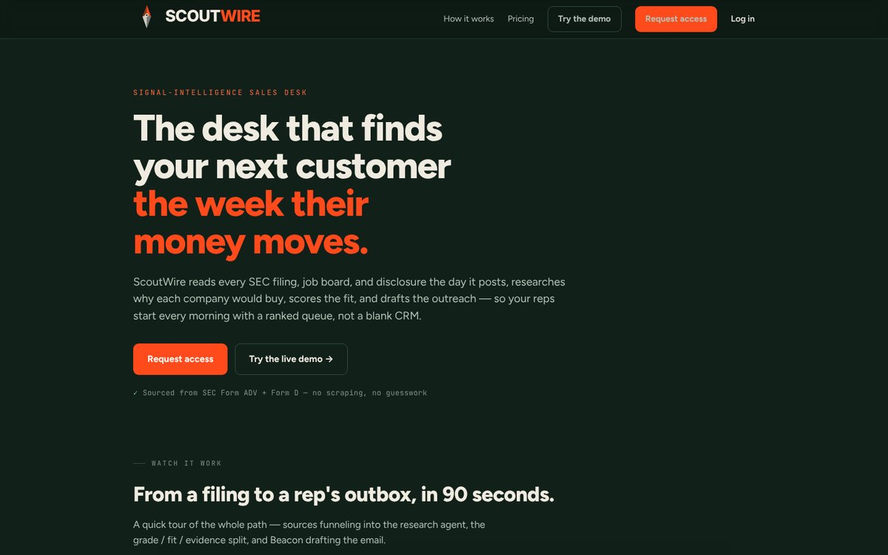
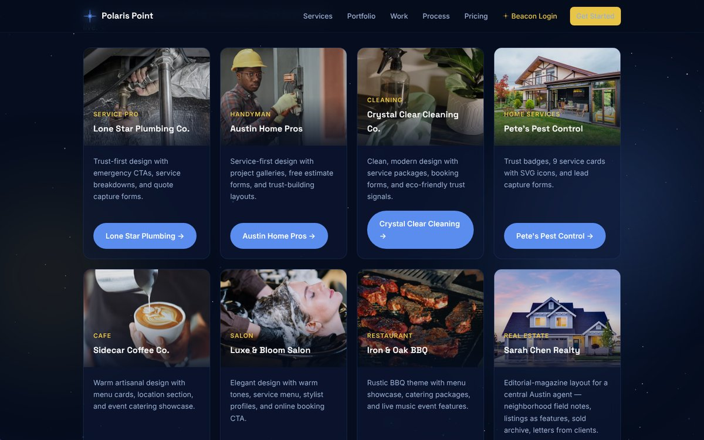
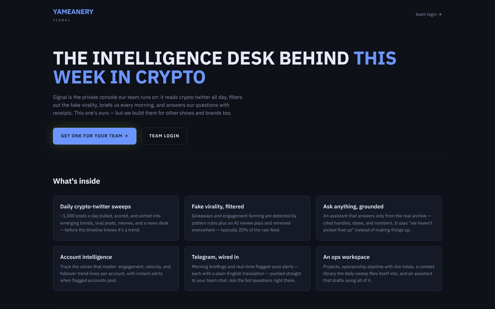
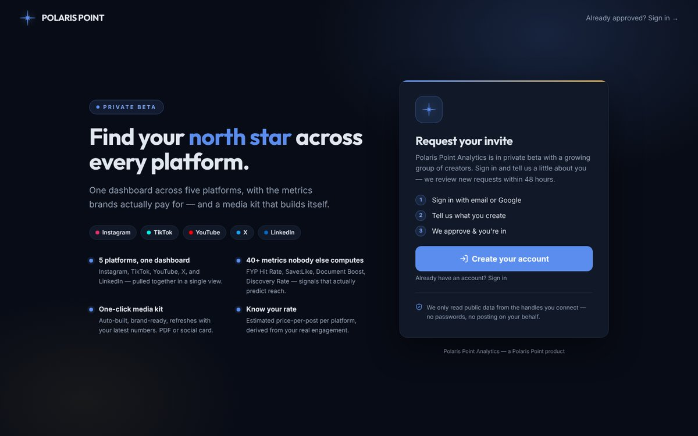
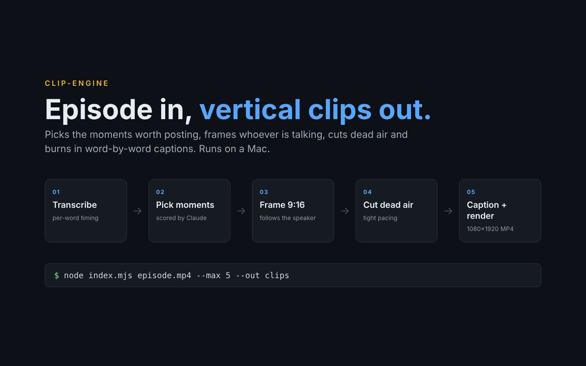

# Hi, I'm Pete

Founder of **[Polaris Point](https://polarispoint.io)**, a web and AI studio in Austin, TX. I build fast websites for local businesses, plus the sales and AI tools that run behind them.

**[polarispoint.io](https://polarispoint.io)** · **[peter@polarispoint.io](mailto:peter@polarispoint.io)**

> Most of my code lives in private repos for clients and products. Below are live versions of my favorite projects. Happy to walk through any of them on a call.

---

## Featured work

### ScoutWire: a sales desk that finds your next customer

ScoutWire reads SEC filings, news and job boards to find the companies and funds worth calling the week their money moves. It researches why each lead would buy, scores the fit with a fixed rubric, and drafts a ready-to-send first email. Reps start the morning with a ranked list instead of a blank CRM.

**Built with:** JavaScript · Python · Claude API · Vercel  
**[Try the live demo →](https://scoutwire.vercel.app)**

---

### Polaris Point: website templates for local businesses

A library of ready-to-launch sites for plumbers, handymen, cleaners, pest control, cafes, salons, restaurants and real estate agents. Each one comes with lead-capture forms, booking buttons and a chat assistant. The same codebase runs the studio's client portal and admin tools.

**Built with:** HTML · CSS · JavaScript · Node · Vercel  
**[Browse the portfolio →](https://polaris-point-demos.vercel.app/#portfolio)**

---

### Yameanery Signal: the intelligence desk for a crypto show

The private console behind *This Week In Crypto*. Every day it pulls about 1,000 crypto-Twitter posts, filters out fake virality, and sorts the rest into trends, viral posts and news. The team gets a morning briefing, Telegram alerts, and an assistant that answers only from the real archive.

**Built with:** JavaScript · Node · Vercel cron · Claude API  
**[Visit the site →](https://yameanery.vercel.app)**

---

### Polaris Point Analytics: one dashboard for creators

Brings Instagram, TikTok, YouTube, X and LinkedIn into one view with 40+ metrics, an auto-built media kit, and an estimated price per post. Currently in private beta.

**Built with:** Next.js · TypeScript · Tailwind · Clerk · Neon Postgres · Vercel  
**[Request an invite →](https://analytics.polarispoint.io)**

---

### clip-engine: podcast episode in, vertical clips out

Give it a video file or a YouTube link. It picks the moments worth posting, frames whoever is talking in 9:16, cuts dead air, and burns in word-by-word captions with a headline. Everything heavy runs locally on a Mac, at about 6 seconds per finished clip.

**Built with:** Node · whisper.cpp · Apple Vision (Swift) · ffmpeg · Claude API  
*Runs on a Mac, so there's no live link.*

---

## What I work with

Next.js · TypeScript · JavaScript · Node · Python · Tailwind · Vercel · Neon Postgres · Supabase · Clerk · Claude API
